<div align="center">



<p>
  <a href="https://github.com/obelisk-app/obelisk-design/stargazers"></a>
  <a href="https://github.com/obelisk-app/obelisk-design/commits/main"></a>
  
  
</p>

<h3>
  <a href="design-system/README.md">🎨 Design system</a>
  &nbsp;·&nbsp;
  <a href="security-workflows/README.md">🔐 Security workflows</a>
  &nbsp;·&nbsp;
  <a href="development-style/README.md">🧭 Development style</a>
  &nbsp;·&nbsp;
  <a href="https://obelisk.ar">🗿 obelisk.ar</a>
</h3>

</div>

Canonical design, security workflow, and development style documentation for the Obelisk family of projects.

This repository collects the shared rules that were previously scattered across `obelisk`, `obelisk-dex`, `obelisk-relay`, and `obelisk-sfu`. It should stay concise and link back to implementation-specific docs when the details belong in a product repo.

## 🎨 The La Crypta palette

<div align="center">

</div>

The green accent is kept for trust, authentication, online, and primary confirmation states. Reach for the `lc-*` classes (`lc-card`, `lc-pill-primary`, `lc-pill-secondary`, `lc-spinner`) and CSS variables before adding new styling primitives. Full list in [La Crypta tokens and patterns](design-system/la-crypta.md).

## 🗿 Product marks

<table>
<tr>
<td align="center" width="25%"><br><b>Obelisk</b><br><sub><code>obelisk-app.svg</code></sub></td>
<td align="center" width="25%"><br><b>Obelisk Relay</b><br><sub><code>obelisk-relay.svg</code></sub></td>
<td align="center" width="25%"><br><b>Obelisk SFU</b><br><sub><code>obelisk-sfu.svg</code></sub></td>
<td align="center" width="25%"><br><b>Obelisk Agents</b><br><sub><code>obelisk-agents.svg</code></sub></td>
</tr>
</table>

Use these for the product, never an instance's own icon (e.g. the purple "P" of `public.obelisk.ar`). Marks are SVG, not Unicode glyphs.

## Sections

- [Design system](design-system/README.md) - La Crypta/Obelisk visual language, tokens, and UI rules.
- [Security workflows](security-workflows/README.md) - Nostr auth, operator admin, storage, and threat-model defaults.
- [Development style](development-style/README.md) - Engineering conventions for frontend, docs, tests, and specs.

## 🗂️ What's inside

```
design-system/
  README.md              core rules: lc-* first, dense admin tools, cards only for bounded things
  la-crypta.md           tokens, component patterns, login surfaces
  admin-shell.md         the one shell shared by the relay, SFU and agents consoles
  logos/                 obelisk-app · obelisk-relay · obelisk-sfu · obelisk-agents (SVG)
security-workflows/
  README.md              Nostr-first defaults: NIP-07/46 signers, NIP-42, NIP-98
  nostr-auth.md          signing in with Nostr
  admin-console-auth.md  how operator consoles authenticate
  operator-admin.md      operator boundaries for privileged services
  app-sandbox.md         cross-project rules for running Obelisk Apps
development-style/
  README.md              reuse local patterns, tests at the risk boundary
  frontend.md            frontend conventions
  docs-and-specs.md      where docs and specs live
  nostr-links.md         public /p/<nprofile>, /notes/<nevent>, /t/<tag> links
  readme-showcase.md     how Obelisk READMEs are dressed: animated SVGs, tours, counters
  real-footage-backlog.md  real recordings still missing, repo by repo
tools/readme/
  snap.cjs               screenshot an animated SVG at chosen seconds
  tour.py                build the animated WebP screenshot tour
```

## 🧰 One shell, three consoles

| Console | Code | Served at |
|---|---|---|
| Relay admin | `obelisk-relay/frontend/src/components/admin/AdminPanel.tsx` | `/admin` on the relay |
| SFU admin | `obelisk-sfu/admin-ui/src/components/Console.tsx` | `/admin/` on the SFU |
| Agents manager | `obelisk-agents/frontend/src/components/Layout.tsx` | `agents.obelisk.ar` |

The relay console is the reference: when the three disagree, match the relay. See [Admin console shell](design-system/admin-shell.md).

## Source References

- `obelisk_repo/README.md` and `obelisk-dex/README.md` for contribution and design-system guidance.
- `obelisk-sfu/docs/sfu-system.md` for operator-run SFU trust boundaries.
- `obelisk-relay/frontend/src/components/admin/AdminPanel.tsx`, `obelisk-sfu/admin-ui/src/components/Console.tsx` and `obelisk-agents/frontend/src/components/Layout.tsx` for the shared admin shell.
- `obelisk_repo/docs/uploads.md` for storage threat-model language.
- `obelisk_repo/docs/admin-cli.md` for operator and agent-admin workflows.
- `obelisk-dex/src/services/social/note-links.ts` and `src/services/social/identifier.ts` for the public `/p`, `/notes` and `/t` link shapes.

## 🌐 The Obelisk family

| | |
|---|---|
| 🗿 [**obelisk**](https://github.com/obelisk-app/obelisk) | The client: Nostr-native chat and voice with Web-of-Trust filtering. Live at [obelisk.ar](https://obelisk.ar) |
| 🏝️ [**obelisk-sky**](https://github.com/obelisk-app/obelisk-sky) | A 3D village that is an Obelisk client. Live at [sky.obelisk.ar](https://sky.obelisk.ar) |
| 📡 [**obelisk-relay**](https://github.com/obelisk-app/obelisk-relay) | NIP-29 groups relay |
| 🎙️ [**obelisk-sfu**](https://github.com/obelisk-app/obelisk-sfu) | mediasoup SFU for voice channels |
| 🤖 [**obelisk-agents**](https://github.com/obelisk-app/obelisk-agents) | Nostr bots for NIP-29 groups |
| 🎲 [**obelisk-apps**](https://github.com/obelisk-app/obelisk-apps) | Games and apps published as Nostr events |

<div align="center">
<br>
<a href="https://github.com/obelisk-app/obelisk-design/stargazers"></a>
</div>
