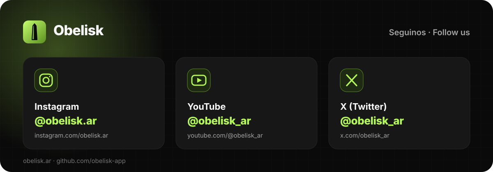

# Social Accounts

Obelisk's official accounts. This page is the source of truth: when a handle changes, change it here first, then everywhere listed under "Where it's used".

| Network | Handle | URL |
|---|---|---|
| Instagram | `@obelisk.ar` | https://www.instagram.com/obelisk.ar |
| YouTube | `@obelisk_ar` | https://www.youtube.com/@obelisk_ar |
| X (Twitter) | `@obelisk_ar` | https://x.com/obelisk_ar |

Also official: https://obelisk.ar (the app) and https://github.com/obelisk-app (the code).

Always write the handle with its `@`, exactly as above. Instagram uses a dot (`obelisk.ar`), YouTube and X an underscore (`obelisk_ar`); the two are not interchangeable.

## The card



`social/social-card.svg` (1200×420) is the static card in the La Crypta theme: dark grid, lime glow, the Obelisk mark and one tile per network. Use it where a picture is enough, such as a README footer, a deck slide or a press kit. An SVG in `` can't hold links, so put the clickable list next to it.

The network glyphs on the card and in the apps are simple line drawings in the accent colour, not the networks' official logos.

## Where to put them

After the page's main call to action, never before it: following is the softer next step for someone not signing up today. Repeat them as small icons in the footer, where people look for them.

## Snippets

**README badges**, clickable:

```markdown
[](https://www.instagram.com/obelisk.ar)
[](https://www.youtube.com/@obelisk_ar)
[](https://x.com/obelisk_ar)
```

(shields.io reads `__` as one underscore.)

**Plain list**, for a footer or a bio:

```markdown
Instagram [@obelisk.ar](https://www.instagram.com/obelisk.ar) · YouTube [@obelisk_ar](https://www.youtube.com/@obelisk_ar) · X [@obelisk_ar](https://x.com/obelisk_ar)
```

**Links that open a new tab** always carry `rel="noopener"`.

## Where it's used

| Place | What |
|---|---|
| obelisk (obelisk-dex) | `SOCIAL_ACCOUNTS` in `src/constants/marketing/social.ts`. The landing ends with `SocialSection` ("Follow Obelisk", en/es/pt), after the closing call to action, and the site footer repeats them as round icons under the brand blurb. Icons: `InstagramIcon`, `YouTubeIcon`, `XLogoIcon` in `src/assets/icons/` |
| obelisk-sky | The landing's `#social` section, after "The island is up. Come in.", and round icons at the end of the footer (`client/index.html`, copy in `client/src/landing/copy.ts`, styles in `landing.css`) |
| obelisk-media | `instagram/PERFIL.md`, the Instagram profile's links |
